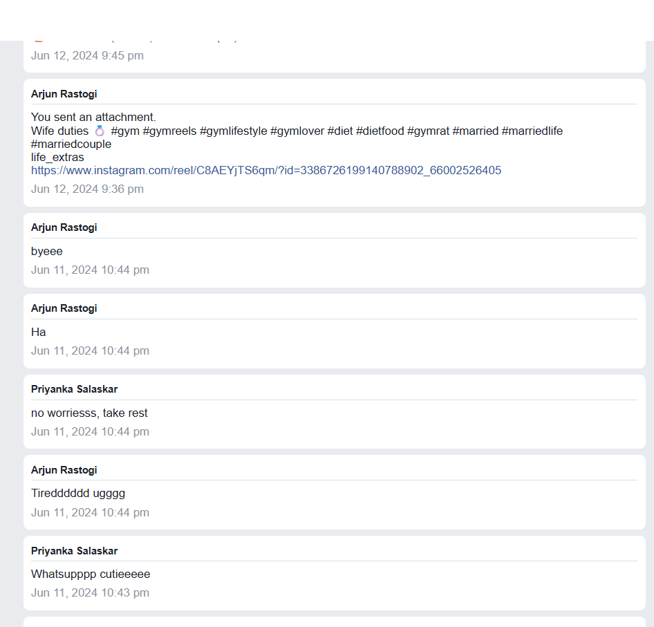
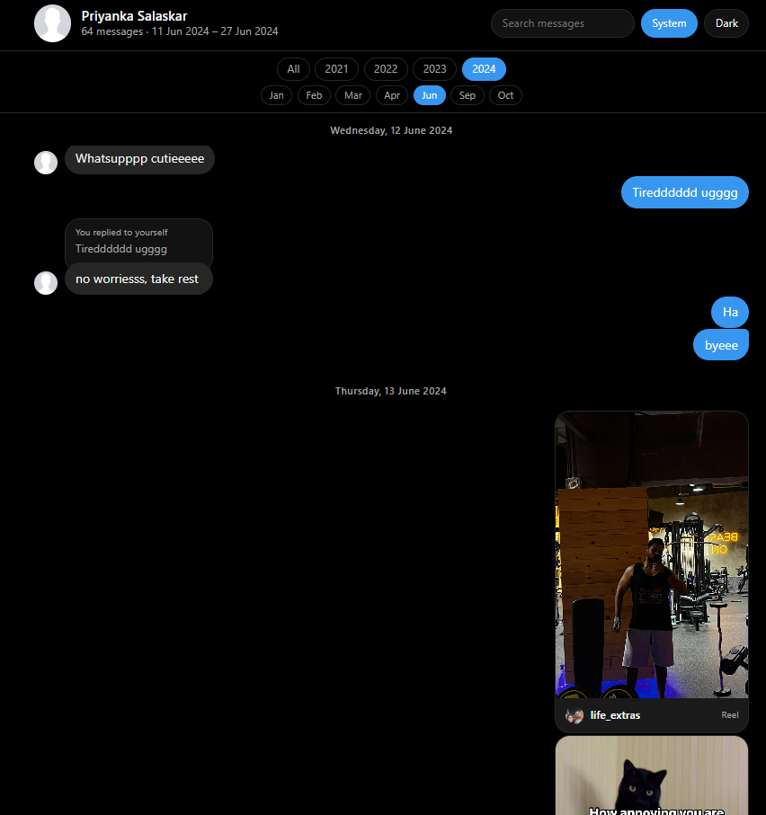
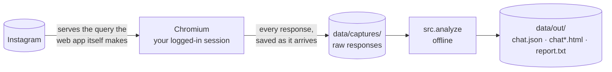
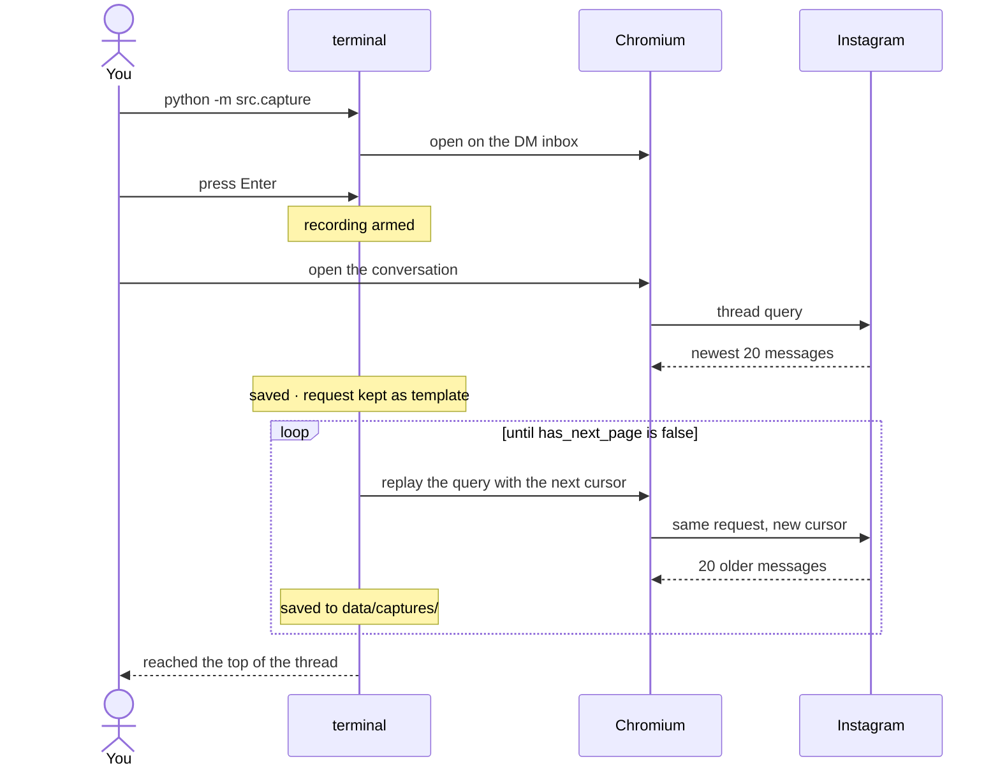

# instagram-chat-scrapper

Rebuild a complete, readable archive of one Instagram direct-message thread from
the network responses Instagram's own web app makes — because the official data
export throws away most of what makes a conversation legible.

Everything stays on your machine.

> **Early project, and it reads an API that is not meant for this.**
> Please read [Status and warning](#status-and-warning) before relying on it.

## Contents

- [Status and warning](#status-and-warning)
- [Why this exists](#why-this-exists)
- [The difference, side by side](#the-difference-side-by-side)
- [What you get](#what-you-get)
- [How it works](#how-it-works)
- [Requirements](#requirements)
- [Usage](#usage)
  - [1. Capture the thread](#1-capture-the-thread)
  - [2. Check what you captured](#2-check-what-you-captured)
  - [3. Build the reading view](#3-build-the-reading-view)
  - [4. Download the media](#4-download-the-media-optional-slow)
- [Commands and flags](#commands-and-flags)
- [How this was tested](#how-this-was-tested)
- [Known limitations](#known-limitations)
- [Privacy](#privacy)
- [Repo layout](#repo-layout)
- [License](#license)
- [Developer documentation](docs/DEVELOPERS.md)
- [Contributing](CONTRIBUTING.md)

## Status and warning

**This exists so conversations are not lost.** A long thread is worth something —
and Instagram gives you no real way to keep it. Telegram will hand you a readable
export of a chat; Instagram hands you a folder of disconnected rows with the
replies, shares and context stripped out. That gap is the only reason this was
written, and the reason it is open source rather than a private script.

**It is in an early phase, so expect it to break.** The capture flow has been run
end to end on real conversations and works, but the surface is wide: message
types nobody has hit yet, threads shaped differently from the ones tested,
accounts in other states. If something breaks and you work out why, a fix PR is
genuinely welcome — see [CONTRIBUTING.md](CONTRIBUTING.md).

**Instagram can change the endpoint or the response shape at any time.** This
reads an internal, unversioned API by replaying the web app's own request. There
is no contract behind it and no deprecation notice when it changes. When that
happens, capture may stop early or `analyze report` will list message shapes it
no longer recognises — the tooling is built to say so loudly rather than fail
quietly, but it will still need fixing.

**Use it responsibly.** Archive conversations you are part of, on an account you
own. A thread belongs to the other person as much as to you: they did not agree
to being archived, so keep what you capture private, do not republish it, and be
careful what you paste into issues or screenshots. Nothing here uploads anything
anywhere — what happens to the archive afterwards is on you.

## Why this exists

Request "Download your information" from Instagram, open the `messages` folder,
and every message is a flat, standalone row. In both the JSON and the HTML
flavours:

- **replies lose their target.** A reply is just another message; nothing records
  what it was replying to, so a conversation full of threaded replies reads as
  disconnected fragments.
- **shared posts, reels and stories** arrive as bare links or not at all.
- **reactions, voice notes, view-once media and system events** are flattened or
  missing.

Open the same conversation on instagram.com and it renders correctly, because the
web app calls a GraphQL query that returns far more: each reply carries the
**entire message it replies to, nested inside it**, plus structured attachment
cards, reactions with their senders, and the message type.

So rather than fight the export: drive the real web app, record what it receives,
and rebuild the thread offline from that.

## The difference, side by side

The same conversation, as the official export renders it and as this rebuilds it:

| Instagram's official export | This archive |
| :---: | :---: |
|  |  |
| replies detached, shares reduced to links | replies quoted inline, shares as cards |

## What you get

- `data/captures/` — every raw response, exactly as received, written as it arrives
- `data/out/chat.json` — one normalised, de-duplicated message list
- `data/out/chat*.html` — a self-contained, Instagram-like reading view: reply
  quotes that jump to the quoted message, reactions, media, day and time dividers,
  search, and a dark mode
- `data/out/report.txt` — what was captured, whether it is complete, and whether
  anything in it was not understood

All of `data/` is gitignored.

## How it works



1. **Capture** opens a real Chromium with a persistent profile, so you log in once.
   Nothing is recorded until you press Enter.
2. You open the conversation. Its first request is recorded, and that request is
   kept in memory as a **template**.
3. From then on the tool stops touching the UI. It replays that same request from
   inside the page with the next pagination cursor, over and over, until Instagram
   says there is nothing older. Each response is saved the moment it lands.
4. **Analyse** reads those files offline, normalises every message shape it knows,
   and writes the JSON and the HTML.

A run looks like this:



Nothing is sent anywhere. The only outbound traffic is to Instagram itself, plus
the optional media download, which goes to Instagram's own CDN.

For the mechanics — the query shape, the message types, how pagination and
resuming work — see [docs/DEVELOPERS.md](docs/DEVELOPERS.md).

## Requirements

- Python 3.10+ (uses `X | None` type syntax and the walrus operator)
- [Playwright](https://playwright.dev/python/) with Chromium
- An Instagram account that can open the conversation in a browser
- Disk: raw captures run roughly 60 KB per 20-message page, so a 90,000-message
  thread is a few hundred MB of JSON, plus a similar amount again for the HTML

```bash
python -m venv venv
source venv/bin/activate
pip install playwright
playwright install chromium
```

No other dependencies — the analyser is standard library only.

## Usage

### 1. Capture the thread

```bash
python -m src.capture
```

A Chromium window opens on the DM inbox. Then, in order:

1. Log in if needed. **Press Enter in the terminal before you go looking for the
   conversation** — see the limitation below for why this matters.
2. Open the conversation you want. The tool waits for it, says
   `captured the thread query — API paging is available`, and starts.
3. Leave it running. It prints a line per page and stops on its own when it
   reaches the beginning of the thread.

`Ctrl+C` pauses rather than quits: recording stops, the browser is yours to poke
at, and `r` resumes from the same cursor. A second `Ctrl+C` stops the run. The
browser is never closed behind your back — on a crash or at the top of the thread
it stays open and tells you what happened.

If the browser dies, just run the command again: it offers to continue from the
furthest-back cursor already on disk instead of starting over.

### 2. Check what you captured

```bash
python -m src.analyze report
```

Read four things:

- **UNHANDLED** should say `every message matched a known shape`. If it lists
  message ids, the renderer would show those as "Unsupported" — the shape is new
  and the parser needs a branch for it.
- **COVERAGE** — the date range, and `unique messages` vs `nodes seen`.
- **CONTINUITY → cursor chain** — `all N paged requests follow a captured page`
  means no page was skipped.
- **rendered as** — a count per message kind; `unknown` should be zero.

### 3. Build the reading view

```bash
python -m src.analyze build --me <your-username>
```

Open `data/out/chat.html`. Images will be missing at this stage — that is expected.

### 4. Download the media (optional, slow)

```bash
python -m src.analyze build --me <your-username> --media
```

One request per image, serially. Expect failures on older messages: Instagram's
CDN links are signed and expire within days, so anything shared more than a few
days ago is usually gone. Failures leave a visible placeholder rather than a hole.
The download caches by URL, so stopping and re-running only fetches what is
missing.

## Commands and flags

### `python -m src.capture`

| Flag | What it does |
| --- | --- |
| *(none)* | Replay the thread's own GraphQL query, cursor by cursor. Constant memory, no ceiling on thread length. |
| `--scroll` | Drive the UI by scrolling instead. Slower, and the renderer runs out of memory at roughly 20,000 messages — kept as a fallback if a replayed request is ever refused. |
| `--images` | Let the page load images, video and fonts. Off by default: media URLs come from the JSON, never from the rendered page, so loading them only costs memory. |
| `--delay N` | Seconds between paged requests (default `1.2`, jittered). Raise it if Instagram starts refusing requests. |

### `python -m src.analyze report [input]`

Describes the captures and flags anything unrecognised. `input` defaults to
`data/captures`. `-o/--out` sets where `report.txt` is written (default `data/out`).

### `python -m src.analyze build [input]`

| Flag | What it does |
| --- | --- |
| `--me <id>` | Which participant is you — a username, numeric id or display name. Decides which side of the conversation is on the right. |
| `--title <text>` | Page title. |
| `--split auto\|month\|year\|none` | How to break up the archive. `auto` (default) keeps one page under 3,000 messages, splits by year above that, and by month above 20,000. A busy year can be 80,000 messages, which is too much for one page. |
| `--media` | Download images and avatars into `data/out/media/` and point the pages at the local copies. |
| `--media-video` | With `--media`, also download video originals. Large, and the least likely to still resolve. |
| `-o/--out <dir>` | Output directory (default `data/out`). |

## How this was tested

End to end, against a real account, on two separate conversations — one of about
94,000 messages over three and a half years, another of about 94,000 over six
months. The run used was:

1. `python -m src.capture`
2. log in, land on the inbox
3. find the conversation in the inbox list
4. press Enter in the terminal to start recording
5. click into the conversation and scroll it once, so the first thread request fires
6. leave it alone — the tool takes over and pages to the beginning by itself

Afterwards, `analyze report` confirmed the capture: zero duplicate message ids, an
unbroken cursor chain across every paged request, and no unrecognised message
shapes. The parser and renderer were also exercised against a synthetic thread
containing one of every message kind.

The individual pieces — request rewriting, the capture loops, pause and resume,
crash handling, the resume-from-disk cursor — were tested with a stubbed browser,
since those paths are hard to trigger on demand against the real site.

## Known limitations

**The newest ~20 messages can be missing.** Scrolling the inbox list to find a
conversation makes Instagram prefetch that thread's most recent messages. If that
happens before you press Enter, those messages are already in the browser's cache,
so opening the conversation does not re-request them and they never appear in a
recorded response. *Work around it by pressing Enter before you scroll the inbox
at all* — or, if you have already captured, scroll up and back down inside the
open conversation to force a refetch.

**Media expires.** Instagram's CDN URLs are signed and short-lived. The archive
always keeps the URLs, but `--media` can only download what is still being served,
which in practice means recent messages.

**View-once media is unrecoverable.** Consumed view-once photos come back as a
12×12 blurred placeholder with no full-size version anywhere. These are shown as
"Photo unavailable" rather than as a meaningless smudge.

**One thread per capture directory.** `data/captures/` is assumed to hold a single
conversation. Archive a second one into a different directory, or move the first
out of the way.

**Instagram can change the query at any time.** This reads an internal, unversioned
API. If the shape changes, `analyze report` will say so under UNHANDLED rather than
failing silently.

## Privacy

- Auth tokens (`fb_dtsg`, `lsd`, and friends) are stripped from every request
  before it is written to disk. The one exception is the in-memory request
  template used for pagination, which is never written or printed.
- Captures, output and the browser profile all live under paths that `.gitignore`
  covers.
- Nothing is uploaded. There is no telemetry and no third-party service.

## Repo layout

```
src/capture/          record a thread from the live web app
  config.py           tunables and fixed values
  state.py            the single run-state dict
  util.py             shared helpers
  terminal.py         stdin, Ctrl+C pausing, end-of-run reports
  recording.py        saving responses, stripping auth, tracking progress
  browser.py          launching Chromium, wiring pages, blocking media
  paging.py           replaying the thread query by cursor (default)
  scrolling.py        driving the UI (fallback)
  resume.py           finding and offering the saved cursor
  __main__.py         entry point

src/analyze/          turn captures into an archive
  load.py             find message nodes in any capture shape
  parse.py            raw node -> render-ready message
  schema.py           the report, including what was not understood
  render.py           markup for one page
  pages.py            splitting, navigation and the index
  assets.py           the stylesheet and script
  media.py            optional CDN mirroring
  __main__.py         entry point

data/                 gitignored
  captures/           raw responses
  out/                chat.json, chat*.html, media/, report.txt
```

## License

[MIT](LICENSE). The copyright line names the project's contributors rather than
an individual — change it if you want your own name on it.
