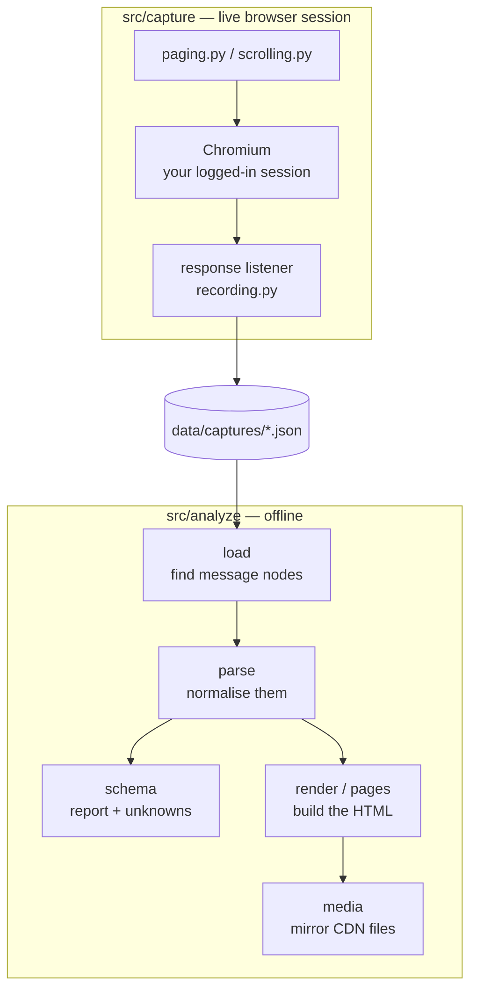
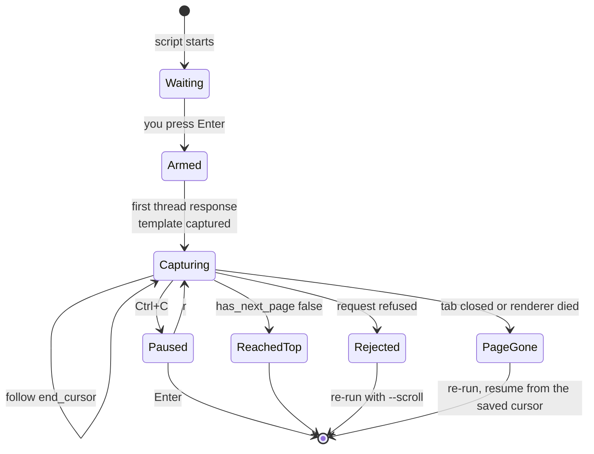
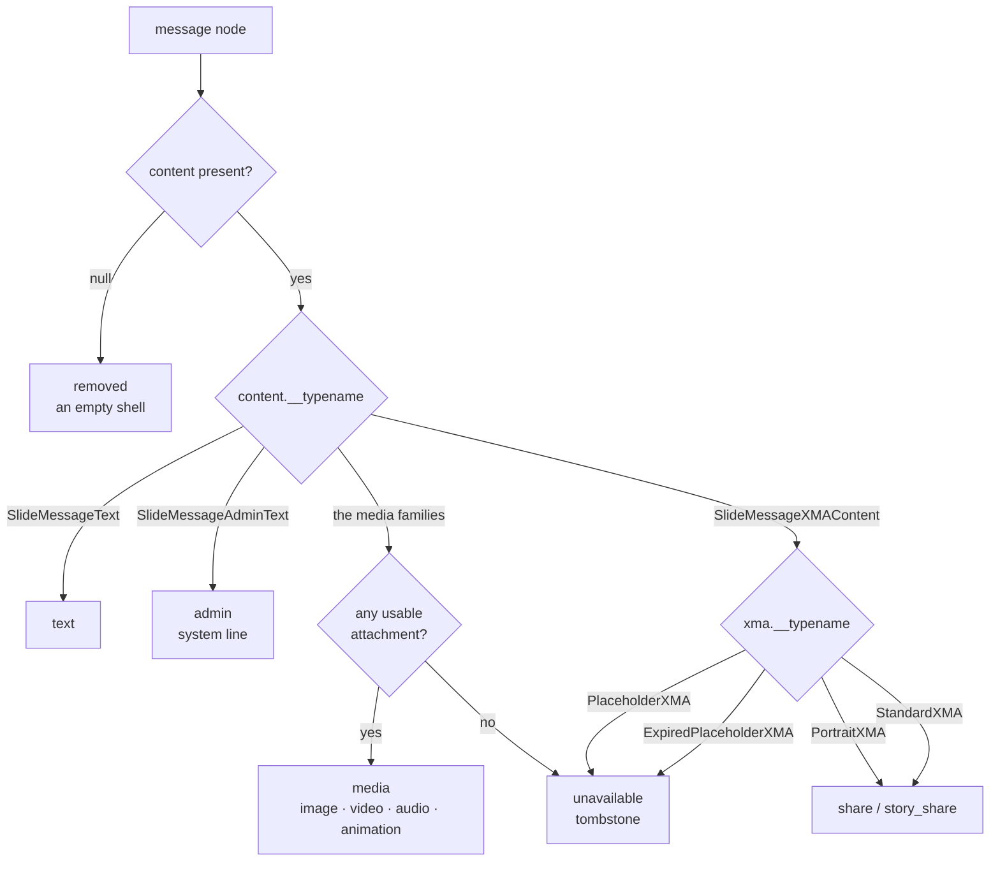

# instagram-chat-scrapper — how it works

Technical notes for anyone changing this. For what it is and how to run it, see
the [README](../README.md).

Participants are referred to as **userA** and **userB** throughout.

## Contents

- [1. The two halves](#1-the-two-halves)
- [2. What Instagram actually returns](#2-what-instagram-actually-returns)
- [3. Capture](#3-capture)
- [4. Analyse](#4-analyse)
- [5. Adding a new message type](#5-adding-a-new-message-type)
- [6. Pitfalls worth knowing](#6-pitfalls-worth-knowing)
- [7. Testing](#7-testing)

---

## 1. The two halves



The halves share nothing but the files in `data/captures/`. Capture never
interprets a message beyond counting it; analyse never touches the network except
for the optional media download.

---

## 2. What Instagram actually returns

The web app pages a conversation with a single GraphQL query. The response
contains a Relay connection named `slide_messages`:

```jsonc
{
  "data": { "...": { "...": {
    "slide_messages": {
      "edges": [ { "node": { /* a message */ }, "cursor": "..." } ],
      "page_info": {
        "start_cursor": "...",
        "end_cursor": "...",       // where the next (older) page begins
        "has_next_page": true,     // false means the top of the thread
        "has_previous_page": true
      }
    }
  } } }
}
```

Three things matter:

- **20 messages per page.**
- **Edges come back newest-first.** "Next page" therefore means *older*, and
  `end_cursor` is the handle for it.
- **Cursors are opaque** and not comparable to each other. The only way to know
  two pages are adjacent is that one asked for a cursor the other handed out.

The wrapper path around `slide_messages` has changed between app versions, so
nothing in this repo depends on it. `load.py` and `recording.py` both walk the
decoded JSON and act on *any* object with a `slide_messages` connection.

### The message node

```jsonc
{
  "__typename": "SlideMessage",
  "message_id": "mid.$cAAA...",          // note the '.' and '$'
  "timestamp_ms": "1600000000000",       // string
  "sender_fbid": "...",
  "sender": { "name": "...", "id": "...", "igid": "...",
              "user_dict": { "username": "...", "profile_pic_url": "..." } },
  "content_type": "TEXT",                // coarse label
  "content": { "__typename": "SlideMessageText", "...": "..." },   // the real discriminator
  "reactions": [ { "reaction": "😂", "sender_fbid": "..." } ],
  "replied_to_message": { /* a whole message node, nested */ },
  "mentions": [], "slide_edit_history": [], "is_pinned": false, "igd_is_forwarded": false
}
```

`replied_to_message` is the point of this project. The official export stores a
reply as a standalone row with no link to its target; here the entire quoted
message is embedded, so the same content parser runs on it to build the quote.

Use `content.__typename`, not `content_type`, to decide what a message is —
`content_type` is coarse (for example `MESSAGE_INLINE_SHARE` covers several
visually distinct cards).

---

## 3. Capture

### Arming

Nothing is written until `state["armed"]` is true, which happens when you press
Enter. The response listener is attached before that and simply returns early, so
there is no window where a response is missed because a hook was not yet installed.

### Recording a response

`recording.on_response` fires for every response whose URL matches
`config.URL_PATTERNS`. It writes one JSON file per response, immediately:

```jsonc
{
  "seq": 1,
  "captured_at": 1700000000.0,
  "url": "https://www.instagram.com/graphql/query",
  "status": 200,
  "friendly_name": "IGDMessageListOffMsysQuery",
  "doc_id": "...",
  "request": { /* the decoded form, auth fields removed */ },
  "chunks": [ /* the decoded body */ ],
  "raw": null                              // the body verbatim if it would not parse
}
```

Writing on arrival is deliberate: a crash loses nothing. Files are numbered from
the highest number already present (`recording.next_seq`), so a second run
continues rather than overwriting.

`clean_request` strips `config.SECRET_FIELDS` — `fb_dtsg`, `lsd`, `jazoest` and
the `__`-prefixed tokens — before the record is written. `request.variables` is
decoded from JSON so the pagination cursor is readable later.

`parse_body` copes with three body shapes: plain JSON, a `for (;;);` prefix, and
several JSON objects one per line.

### Paging without the UI (default)

The first response that carries messages is also kept as a **template**
(`recording.remember_template`): its URL, its full POST body *including* the auth
fields, and its headers minus the ones `fetch()` refuses to let a page set
(`config.FETCH_FORBIDDEN_HEADERS`). This lives in `state["template"]`, in memory,
for the lifetime of the run. It is never written to disk and never printed —
which is exactly why `clean_request` strips those fields from everything that is.

`paging.body_with_cursor` then produces the next request by decoding the
form-encoded body, finding the one field holding the GraphQL variables, replacing
the cursor inside it, and re-encoding. Every other field — `doc_id`, the tokens,
the dozens of `__` fields — is copied through unchanged, so what goes out is the
request Instagram's own page would have made.

`paging.FETCH_JS` runs that request **inside the page**, not from Python:

- it is same-origin, so the session cookies apply with no handling on our side;
- Playwright's `response` event fires for a page-issued `fetch`, so
  `on_response` saves the body with no extra work;
- only pagination metadata (`count`, `end_cursor`, `has_next_page`) crosses back
  over the bridge — the messages themselves never pass through Python here.

The loop then follows `end_cursor` until `has_next_page` is `false`.

### Why not just scroll?

`--scroll` still exists and drives the UI, which is what the page itself does.
Two problems made it the fallback rather than the default:

1. **Memory.** Instagram's DM pane does not virtualise. Every message scrolled
   past stays in the DOM with its images decoded, and the renderer dies somewhere
   around 20,000 messages. Observed twice, at 931 and 1,171 pages.
2. **It silently skipped data.** On the same conversation, scrolling produced
   18,636 and 23,420 messages on two runs; paging produced 94,375 with an
   unbroken cursor chain. One year alone went from roughly 6,000 messages
   scrolled to 71,255 paged. The scroll loop was dropping large spans without
   any error.

Because paging never grows the DOM, media is blocked at the network layer in both
modes (`browser.block_media`). Media URLs come from the JSON, never from the
rendered page, so refusing to load them costs nothing.

### Stopping, and why

Both loops return `{"reason", "detail", "rounds"}` instead of raising:

| reason | meaning |
| --- | --- |
| `reached_top` | `has_next_page: false`, or a page came back empty |
| `idle` | scroll mode: nothing new for `IDLE_ROUNDS_TO_STOP` scrolls |
| `paused` | Ctrl+C; recording is off and the run can resume |
| `interrupted` | second Ctrl+C |
| `page_gone` | the tab closed or the renderer died |
| `scroll_failed` | `MAX_SCROLL_FAILURES` consecutive scroll errors |
| `api_rejected` | Instagram refused the replayed request (HTTP error, or an unparseable body such as a login wall) |
| `api_failed` | the replay could not be issued |
| `no_template` | no thread request was ever seen |

`terminal.report_outcome` turns each into a plain-language explanation and a next
step. The browser is deliberately never closed on the way out — the run holds at a
prompt so the page can be inspected.



### Pause and resume

Ctrl+C pauses rather than quits. Two details are load-bearing:

- **The SIGINT handler is installed once and never removed.** Removing it calls
  `loop.remove_signal_handler()`, which overwrites `asyncio.Runner`'s own SIGINT
  handler with the plain default — after which Ctrl+C raises `KeyboardInterrupt`
  inside the selector, with a traceback, instead of cancelling cleanly. The
  handler checks what is happening instead: if a prompt is waiting it answers it,
  otherwise it pauses, and a second press stops.
- **`terminal.ainput` reads stdin through the event loop**, via
  `loop.add_reader`. Neither `asyncio.to_thread(input)` nor a daemon thread works:
  both leave a thread blocked in `input()` holding the stdin lock, and the
  interpreter then dies with `_enter_buffered_busy: could not acquire lock for
  <stdin>`. Blocking the loop with a plain `input()` is also out — a pause can
  last minutes and Playwright needs the loop running to keep its connection alive.

While paused, `state["armed"]` is false, so moving around the app records nothing.

### Resuming a dead run

`resume.find_resume_point` reads the newest `RESUME_SCAN_FILES` capture files and
returns the `end_cursor` of whichever page reaches furthest back. Pages are
fetched oldest-last, so the answer is always near the end of the directory — there
is no need to parse thousands of files.

On the next run, once the conversation is open again (which yields a fresh
template), you are offered that cursor. Accepting it skips everything already
captured.

---

## 4. Analyse

### load

`load.py` accepts anything: a raw response body, a capture record, a list of
either, or `.jsonl`. It walks each document for `slide_messages` connections and
returns `Page` objects carrying the nodes, the `page_info`, the edge cursors, and
the cursor the *request* asked for.

Edge cursors live on the **edge**, not the node — reading `cursor` off a node
silently yields `None`, which once made the continuity check pass when it should
not have.

### parse

`parse.build` normalises nodes into one flat list, de-duplicating by
`message_id` and merging field-by-field so a later sighting never blanks out
something an earlier one had. Each message becomes:

```jsonc
{
  "id": "mid.$...", "ts": 1600000000000, "sender_id": "...",
  "kind": "text|media|share|story_share|unavailable|removed|admin|unknown",
  "text": "...|null",
  "card": { /* share card */ } ,
  "media": [ { "kind": "image|video|audio|animation", "preview": "...", "full": "...",
               "width": 0, "height": 0, "duration_ms": null,
               "placeholder": false, "ephemeral": false, "is_sticker": false } ],
  "reply": { "id": "...", "sender_id": "...", "kind": "...", "text": "...", "media": [] },
  "reactions": [ { "emoji": "😂", "sender_id": "..." } ],
  "is_forwarded": false, "is_pinned": false, "edits": 0,
  "content_type": "...", "typename": "..."
}
```

### The message taxonomy

`content.__typename` dispatches:

| `content.__typename` | kind | where the payload is |
| --- | --- | --- |
| `SlideMessageText` | `text` | `content.text_body` |
| `SlideMessageAdminText` | `admin` | `content.text_fragments[].plaintext` |
| `SlideMessageXMAContent` | `share` / `story_share` / `unavailable` | `content.xma`, dispatched again on `xma.__typename` |
| `SlideMessageImageContent` | `media` (image) | `content.attachments[]` |
| `SlideMessageRavenImageContent` | `media` (image) | `content.attachment` (single) |
| `SlideMessageRavenVideoContent` | `media` (video) | `content.attachment` (single) |
| `SlideMessageVideosContent` | `media` (video) | `content.videos[]` |
| `SlideMessageAudiosContent` | `media` (audio) | `content.audio_attachments[]` |
| `SlideMessageAnimatedMediaContent` | `media` (animation) | `content.animated_media[]` |
| `null` (`content_type: NOT_SET`) | `removed` | nothing — an empty shell |

"Raven" is Meta's internal name for disappearing / view-once media.

The media families differ only in *where* the list is and what the URL fields are
called. All of them use `preview_cdn_url`, `attachment_cdn_url`, `preview_width`,
`preview_height` and `attachment_fbid`, except:

- animated media uses `attachment_webp_url` / `attachment_mp4_url`;
- audio has no preview at all, and reads `attachment_cdn_url` or `playable_url`.

`*_cdn_fallback_url` is a bare path into Instagram's `media_fallback` endpoint,
not a usable URL, and is ignored.



`xma.__typename` dispatches the share cards: `SlideMessagePortraitXMA` (a post,
reel or story with a preview image), `SlideMessageStandardXMA` (a share with no
preview, or the "Message expired" tombstone), `SlideMessagePlaceholderXMA`
("Message unavailable"), and `SlideMessageExpiredPlaceholderXMA` (an expired
story share).

### The 12×12 trap

Instagram encodes the render size of an image in the URL path as `_s<W>x<H>`. A
view-once photo that has already been consumed comes back as a **12×12 blur with
no larger URL anywhere** — there is no image left to show.

`parse._usable` drops any URL whose encoded size is `PLACEHOLDER_PX` (64) or
smaller. If that leaves an attachment with nothing, it is discarded; if that
leaves the message with no attachments at all, it falls through to an
"unavailable" tombstone. Without this, 116 of 236 attachments in one archive
would have rendered as stretched smudges.

An attachment that keeps a real original but loses only its preview is marked
`placeholder: true` and rendered as a labelled tile linking to the original,
rather than stretching a blur across the bubble.

### schema (the report)

`schema.report` is the self-check. `KNOWN_CONTENT` and `KNOWN_XMA` list the shapes
the parser handles; anything outside them is listed under **UNHANDLED** with its
message id. The point is that a new Instagram message type surfaces as a line in
the report rather than as a silent "Unsupported" bubble.

**CONTINUITY** checks the cursor chain: every paged request must have asked for a
cursor some captured page handed out. Time gaps between pages are reported too,
but only as information — pages are contiguous by construction, so a gap usually
just means nobody was talking.

### render and pages

`render.render` builds one page. `pages.render_all` decides how many pages there
are: one below 3,000 messages, one per year above that, one per month above
20,000. A single year of a busy conversation can be 80,000 messages, which no
browser enjoys.

When the archive is split, a reply quoting a message in another bucket is
rewritten to `chat-2021-08.html#m-<id>`, and the landing page scrolls to it and
highlights it.

The sticky offsets for the day divider are **measured at runtime** rather than
hardcoded, because the header and the year/month bar wrap differently at different
widths; a hardcoded value left a seam that content scrolled through.

### media

`media.mirror` downloads previews, originals and avatars into `data/out/media/`
and rewrites the chat to point at the local copies, because the signed CDN URLs
expire within days. It caches by URL hash, so re-running only fetches what is
missing, and it refuses any host that is not Instagram's own CDN. Video originals
are opt-in (`--media-video`) because they are large and the least likely to still
resolve.

---

## 5. Adding a new message type

When the report lists something under UNHANDLED:

1. **Look at the real payload first.** Find one of the listed message ids in
   `data/captures/` and print its `content`. Do not guess field names.
2. **Add the branch** in `parse.parse_content`. If it is a media family, adding
   the typename to `MEDIA_CONTENT` and teaching `_media_items` where the list
   lives is usually the whole change.
3. **Add a label** to `MEDIA_NOUNS` / `render.MEDIA_LABELS` if it is a new kind.
   Missing one of these raises `KeyError` on the tombstone path, which is the
   path an empty payload takes.
4. **Render it** in `render._media_html` or `_card_html`.
5. **Whitelist it** in `schema.KNOWN_CONTENT` or `KNOWN_XMA`, or the report keeps
   flagging it.
6. **Re-run `analyze report`** and confirm UNHANDLED is empty and `unknown` is
   zero under "rendered as".

Expect empty payloads. Several types appear with `attachments: []`,
`audio_attachments: []` or `attachment: null` — the message existed, the media is
gone. These should become tombstones, never silent gaps.

---

## 6. Pitfalls worth knowing

**Message ids are not valid CSS selectors.** They look like `mid.$cAAA...`; the
`.` and `$` make `querySelector('#m-mid.$...')` throw. The page uses
`getElementById` everywhere.

**Playwright routes are LIFO.** The last registered handler runs first, and
`route.continue_()` goes to the network rather than falling through to the next
handler. Registering a second route while testing the media blocker meant the
blocker never ran, and the test passed for the wrong reason.

**URL fragments never reach a route handler.** Fragments are not sent in HTTP
requests, so routing on `#something` silently matches nothing — error-path tests
written that way quietly exercise the success path.

**`has_next_page` is the only reliable end signal.** Timestamps cannot tell you
whether a page is missing; a quiet month and a dropped page look identical. The
cursor chain is the real check.

**Empty media payloads are common.** Always handle the list being empty before
indexing into it.

---

## 7. Testing

There is no automated suite in the repo. What was done:

- **End to end**, twice, against real conversations of roughly 94,000 messages
  each — one spanning three and a half years, one spanning six months. Verified
  afterwards with `analyze report`: zero duplicate ids, unbroken cursor chain, no
  unhandled shapes.
- **A synthetic thread** containing one of every message kind — text, reply,
  reaction, system line, image, view-once blur, video, empty audio, removed shell
  and a share card — run through parse, report, render and both split modes.
- **Stubbed-browser tests** for the paths that are hard to trigger on demand:
  request rewriting, both capture loops, every stop reason, pause and resume,
  Ctrl+C at a prompt, and resume-from-disk.

If you add an automated suite, the stub pattern is the useful part: replace
`playwright.async_api` in `sys.modules` with a module exposing `Error` and a fake
page whose `evaluate` returns scripted responses. That covers the loops without a
browser.
